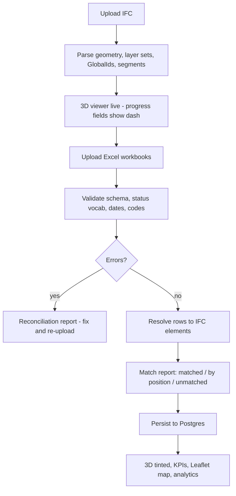

# IFC ↔ Excel Integration Plan

**Status:** proposal — nothing implemented yet
**Inputs analysed:** `Road.ifc`, `Road 60M v02 (1).ifc`, `LayerProgress (2).xlsx`, `Road_chainage.xlsx`, `RoadLayer.xlsx`, `ProjectMetric (1).xlsx`

---

## 1. What these files actually are

The four spreadsheets are **exports of the four core database tables**, not ad-hoc progress sheets. Their columns line up with the existing Postgres schema almost exactly.

| File | Rows | Maps to table | Notes |
|---|---|---|---|
| `RoadLayer.xlsx` | 4 | `RoadLayers` | Layer catalogue: SUB, GSB, BC, SC |
| `Road_chainage.xlsx` | 3 | `RoadChainages` | **Carries real lat/long + elevation** |
| `LayerProgress (2).xlsx` | 12 | `LayerProgress` | 3 chainages × 4 layers |
| `ProjectMetric (1).xlsx` | 1 | `ProjectMetrics` | Roll-up; reconciles exactly with LayerProgress |

`ProjectMetric` totals (Budget 472,500 / Actual 359,500) match the sum of `LayerProgress` exactly, so the export is internally consistent.

---

## 2. The join key already exists

**`LayerProgress.LayerId` holds an IFC GlobalId**, not an integer — but it points at **two different kinds of IFC object**, and that distinction is the whole trick.

```
LayerProgress.LayerId = "1qG2$uZQDCJQNmYAadLbsB"      -> an element
IFC: IFCBUILDINGELEMENTPROXY('1qG2$uZQDCJQNmYAadLbsB', ..., 'Floor:Subgrade:1676685', ...)

LayerProgress.LayerId = "0MMizBrBTEeeb43cp8iy30"      -> a Revit model group
IFC: IFCGROUP('0MMizBrBTEeeb43cp8iy30', ..., 'Model Group:Group 1:1676878', ...)
     IFCRELASSIGNSTOGROUP(..., (#381,#413), $, #484)
```

Verified against `Road.ifc` (identical GlobalIds to `Road 60M v02 (1).ifc` — 15/15 elements, 3/3 groups):

| | |
|---|---|
| `LayerProgress` rows | 12 |
| Resolved directly to an element | 9 |
| Resolved through an `IfcGroup` | 3 |
| **Unresolved** | **0 — 100%** |
| IFC elements covered | 15 / 15 |

Each chainage's four rows land on exactly one 20 m segment: `ch1 -> C`, `ch2 -> B`, `ch3 -> A`.

### Why the `SC` rows use a group

The surface course is modelled as **two lane slabs per segment**, so there is no single element to point at. Whoever built the spreadsheet referenced the Revit model group containing both lanes instead of picking one arbitrarily. That is the correct choice, and it means the fan-out is **declared in the IFC** rather than something the resolver has to infer from geometry.

> **Design consequence:** the resolver must look up `LayerId` in an element index **and** a group index. A group hit expands to its `IfcRelAssignsToGroup` members, and the progress row applies to all of them.

*(An earlier revision of this document diagnosed these three rows as "GlobalId drift from a Revit re-export." That was wrong — it came from searching only the element table. The GUIDs were never stale.)*

---

## 3. Model structure (`Road.ifc`)

Clean, regular, and well suited to automatic mapping.

- **60.00 m** long × **8.80 m** formation × **0.95 m** deep
- **3 segments of exactly 20 m** — one per chainage row
- 15 renderable elements = 3 segments × (Subgrade + Sub base + Base Course + 2 × Surface lane)
- Units: millimetre · Schema: IFC2X3 · Source: Revit 2027 · World origin `(718377.794, 3163960.107, 117.0)` mm

Segment ↔ chainage, from the resolved GUIDs (§2):

| Segment | Model X | World X | Element family | Excel `ChainageId` | `KmLabel` |
|---|---|---|---|---|---|
| A | 0 – 20 m | 718.38 – 738.38 | `1_DMN54lT...` + group 3 | 3 | KM 002 – KM 003 |
| B | 20 – 40 m | 738.38 – 758.38 | `1qG2$uZQ...rS/ra/ri` + group 2 | 2 | KM 001 – KM 002 |
| C | 40 – 60 m | 758.38 – 778.38 | `1qG2$uZQ...sB/sJ/sR` + group 1 | 1 | KM 000 – KM 001 |

**As numbered in the spreadsheet, chainage runs opposite to model +X** — which contradicts the site georeference (§4). A position-based fallback must not assume they increase together, and must take its direction from a resolved anchor rather than guessing.

### Layer stack (from `IfcMaterialLayerSet`), with measured extents

| Order | Layer set | Material | Thickness | Z band | Width |
|---|---|---|---|---|---|
| 1 | `Floor:Subgrade` | Earth | 300 mm | −0.88 … −0.58 m | 8.80 m |
| 2 | `Floor:Sub base` | Gravel | 300 mm | −0.58 … −0.28 m | 8.20 m |
| 3 | `Floor:Base Course` | Concrete, Lightweight | 350 mm | −0.28 … +0.07 m | 7.60 m |
| 4 | `Floor:Surface` | Concrete, Cast-in-Place, Gray | 150 mm | crowned | 2 × 3.50 m |

The surface is two lanes at 2.86% camber. Widths step inward with height, so the stack reads as a proper cross-section rather than a flat sandwich.

### Geometry types — a parsing trap

Not every element is a plain box:

| Representation | Elements | Note |
|---|---|---|
| `IfcExtrudedAreaSolid` + `IfcRectangleProfileDef` | 8 | straightforward |
| `IfcExtrudedAreaSolid` + `IfcArbitraryClosedProfileDef` | 1 | segment A base course — shaped cross-section, extruded **along +X** rather than vertically |
| `IfcBooleanClippingResult` over a tilted extrusion | 6 | the surface lanes — cambered and clipped by two half-spaces |

**A bounding-box reader that only handles `IfcExtrudedAreaSolid` with a rectangle profile silently returns nothing for 7 of the 15 elements.** Any segment-bucketing fallback has to walk clipping results and honour the placement axis, or it will drop the entire surface course.

---

## 4. Georeferencing — and a direction conflict

`Road.ifc` **does** carry a site location (unlike what an earlier pass reported), and it is chainage 1 to nine decimal places:

```
IFCSITE(..., (28,37,26,106719), (77,14,1,415405), ...)   ->  28.623918533, 77.233726501
Road_chainage row 1                                       =   28.623918532, 77.233726501
                                                    offset =   0.000 m
```

That site sits at the **model origin**, `IFCLOCALPLACEMENT($, ... (718377.794, 3163960.107, 117.0))`, which is the **west end** of the road. `TrueNorth` is `(0,1)`, so model **+X is east**, and the chainage coordinates run east:

| Id | Latitude | Longitude | Elevation | Distance from site |
|---|---|---|---|---|
| 1 | 28.623918532 | 77.233726501 | 217.00 | **0.00 m** |
| 2 | 28.623911789 | 77.234135394 | 217.10 | 39.92 m |
| 3 | 28.623908418 | 77.234339841 | 217.15 | 59.88 m |

Total span 59.88 m against a 60.00 m model — 0.2%, well within tolerance.

### The conflict

Geographically **ch1 is at model X 0 — segment A**. The spreadsheet assigns ch1 to **segment C**, at X 40–60 m. **The chainage-to-segment order is inverted**, and the site coordinate is now direct evidence rather than the positional inference used previously.

Only one of these can be right, and it decides which end of the model turns green first:

- **Site is authoritative** -> ch1 = the `1_DMN...` family (segment A), ch3 = the `1qG2$uZQ...sB` family. `LayerProgress.ChainageId` needs flipping.
- **Spreadsheet is authoritative** -> chainage is measured from the east end, and the Revit site location was set from the wrong point.

### Uneven spacing

The model is three exactly equal 20 m segments; the coordinates are not:

```
ch1 -> ch2    39.92 m
ch2 -> ch3    19.96 m
```

They fall at 0 / 40 / 60 m, not 0 / 20 / 40. `ch2` looks recorded at the wrong boundary — 40 m instead of 20 m. Since ch1 and ch3 bracket the model correctly, only the middle point is suspect.

---

## 5. Data-quality issues that will break a naïve import

| # | Issue | Detail | Fix |
|---|---|---|---|
| 1 | **Status vocabulary** | Excel: `In Progress`, `Not started` · DB CHECK: `In-Progress`, `Not Started` | Normalise on import — a raw insert **violates the constraint** |
| 2 | **Dates are Excel serials** | `45668` -> 2025-01-11 | Convert via the 1899-12-30 epoch |
| 3 | **`"NULL"` as a string** | `ActualEndDate` contains the literal text `NULL` | Coerce to real null |
| 4 | **Thickness disagrees 3 ways** | SUB: IFC 300 / RoadLayer 300 / LayerProgress 500 · BC: IFC 350 / RoadLayer 250 | Need a precedence rule (§6) |
| 5 | **CostVariance sign** | File uses `Actual − Budget` (+2500 = overspend). App EVM uses `EV − AC` | Pick one convention |
| 6 | **`LayerId` is overloaded** | DB column is `int` FK -> `RoadLayers.Id`; Excel puts an IFC GUID in it — sometimes an element, sometimes an `IfcGroup` | Add a dedicated column (§7) |
| 7 | **`__EMPTY` column** | Trailing blank column in `Road_chainage.xlsx` | Ignore unnamed columns |

---

### 5b. `BC` means two different layers — found while building phase 1

The spreadsheets and the viewer both use short layer codes, and one of them collides:

```
Excel   SUB  GSB  BC  (Base cource)    SC  (Surface cource)
IFC     SUB  GSB  WMM (Base Course)    BC  (Surface)
                  ^^^^^^^^^^^^^^^^     ^^^^^^^^^^^^^
                  "BC" is the base course in the sheet
                  but the wearing course in the model
```

`deriveLayerCode()` in `ifcLoader.js` reads `BC` as *Bituminous Concrete* — the top of the
stack — while the sheet uses it for *Base Course*, third from the bottom. A join on codes
therefore paints base-course progress onto the surface and leaves the real base course
blank, silently and plausibly.

**Fix:** both sides are classified into a shared structural role taken from the layer
**name**, which is unambiguous, and paired on that. Codes are a fallback only for layers
with no usable name, and `BC` is deliberately excluded from the code table because it is
the ambiguous one.

| Excel | Role | Model | Thickness applied |
|---|---|---|---|
| `SUB` Subgrade Earthwork | `SUBGRADE` | `SUB` Subgrade | 300 mm (IFC) |
| `GSB` Granular Sub-Base | `SUBBASE` | `GSB` Sub base | 300 mm (IFC) |
| `BC` Base cource | `BASE` | `WMM` Base Course | 350 mm (IFC) |
| `SC` Surface cource | `SURFACE` | `BC` Surface | 150 mm (IFC) |

`toProgressRows()` emits the **model's** code so everything downstream — 3D tint, Layer
Explorer, KPIs — lands on the right layer, and keeps the sheet's code alongside it for
display.

---

## 6. Proposed linking model

A **resolver** that tries strategies in order and records how each row was matched, so a future re-export degrades gracefully instead of blanking a layer.

| Priority | Strategy | Confidence | Handles |
|---|---|---|---|
| 1 | `LayerId` == IFC element `GlobalId` | exact | 9 of 12 rows today |
| 2 | `LayerId` == IFC **`IfcGroup`** `GlobalId` -> expand to `IfcRelAssignsToGroup` members | exact | the 3 `SC` rows — multi-element layers |
| 3 | (segment index -> ChainageId) + `LayerCode` -> `IfcMaterialLayerSet` name | high | GUID drift after a re-export |
| 4 | element name contains the layer-set name (`Floor:Surface`) | medium | renamed elements |
| 5 | unmatched | — | surfaced in the reconciliation panel |

Strategies 1 and 2 resolve this dataset **completely** — 12/12 rows, 15/15 elements. Strategies 3–4 exist so the system survives a model revision that reissues GlobalIds; they are insurance, not load-bearing today.

**Layer code mapping**, confirmed against the model:

| Excel `LayerCode` | `IfcMaterialLayerSet` | Material | IFC thickness |
|---|---|---|---|
| `SUB` | `Floor:Subgrade` | Earth | 300 mm |
| `GSB` | `Floor:Sub base` | Gravel | 300 mm |
| `BC` | `Floor:Base Course` | Concrete, Lightweight | 350 mm |
| `SC` | `Floor:Surface` | Concrete, Cast-in-Place, Gray | 150 mm |

**Thickness precedence:** IFC `IfcMaterialLayerSet` (as-modelled) -> `LayerProgress.DesignThicknessMm` (as-designed override) -> `RoadLayer.ThicknessMm` (catalogue default). Every row currently disagrees with the model, so the UI must show which source won rather than silently resolving it:

| Layer | IFC | `DesignThicknessMm` | Delta |
|---|---|---|---|
| SUB | 300 | 500 | +200 |
| GSB | 300 | 200 | −100 |
| BC | 350 | 250 | −100 |
| SC | 150 | 100 | −50 |

---

## 7. Schema changes

```sql
ALTER TABLE "LayerProgress" ADD COLUMN "IfcGlobalId"   text NULL;
ALTER TABLE "LayerProgress" ADD COLUMN "IfcRefKind"    text NULL;  -- element | group
ALTER TABLE "LayerProgress" ADD COLUMN "MatchStrategy" text NULL;  -- guid | group | position | name | none
CREATE INDEX "IX_LayerProgress_IfcGlobalId" ON "LayerProgress"("IfcGlobalId");

ALTER TABLE "RoadChainages" ADD COLUMN "IfcModelFileName" text NULL;
```

`LayerId` stays the integer FK to `RoadLayers`; the GUID moves to `IfcGlobalId` where it belongs. The importer resolves `LayerCode` -> `RoadLayers.Id` for the FK.

---

## 8. Upload flow

**IFC first, then Excel.** The model defines what exists; the spreadsheets say how far along it is. Loading progress for elements you cannot yet show is the weaker order.



Both orders must work — if Excel arrives first it is staged and resolved when the IFC lands.

### Upload screen

One **Project Data Import** page with four labelled drop zones (Chainages · Layers · Progress · Metrics) plus the IFC slot, accepting a single multi-sheet workbook as an alternative. Each zone shows row count, validation result and a preview. A single **Import** action commits, and nothing is written until every file validates.

### Reconciliation report (required, not optional)

After import, show exactly what happened:

```
12 progress rows · 15 IFC elements
  OK   9 matched by GlobalId
  WARN 3 matched by position + layer code   (SC - GlobalIds changed in v02)
  ERR  0 unmatched
  INFO 6 IFC elements carry no progress row (Surface lanes - covered by fan-out)
```

---

## 9. Leaflet map with all layers

Goal: the plan-view equivalent of the 3D stack.

- **Per-layer polygons.** Each element's plan footprint transformed model -> geographic.
  > **Corrected during implementation.** This section assumed the model carried no `IfcSite`
  > and proposed a Helmert fit of the chainage coordinates instead. `Road.ifc` *does* carry one,
  > and it is exact — it places all three chainage points within 0.05 m of their own coordinates.
  > The `IfcSite` anchor is now preferred and the survey fit is the fallback; both are computed and
  > the source can be switched on the map. The fit also holds **scale at 1:1** — allowing it to float
  > stretched the model 50% and drew a 90 m road from a 60 m model. See §Phase 5 below.
- **Layer selector** — SUB / GSB / BC / SC, matching the 3D layer pills. One layer at a time, or:
- **Exploded mode** — layers drawn with a small perpendicular offset so the whole stack is visible at once, like a fanned cross-section.
- **Status colouring** from `LayerProgress`, reusing the existing tint palette so 3D and map agree.
- **Click a segment** -> popup with chainage, layer, status, progress %, thickness, budget/actual, and the match strategy used.
- **Chainage markers** at each `Road_chainage` point labelled with `KmLabel`.

The existing `IfcRoadMap.jsx` already draws a single georeferenced ribbon; this extends it from one outline to a per-layer, per-segment, status-coloured set.

---

## 10. Phases

| Phase | Deliverable | Status | Depends on |
|---|---|---|---|
| **1** | Excel import + validation + normalisation (status, dates, `"NULL"`, unnamed cols, layer-role reconciliation) | **done** | — |
| **2** | Resolver (GUID -> IfcGroup -> position -> name) + reconciliation report | **done** | 1 |
| **3** | Wire matched progress into 3D tint, Layer Explorer, KPIs, analytics | **done** | 2 |
| **4** | Schema migration + persist through the backend, with JWT auth and project membership | **done** | 1, 2 |
| **5** | Leaflet per-layer map (selector, exploded mode, popups) | **done** | 2 |
| **6** | Upload wizard UX + both-orders support | **done** | 1–5 |

### Phase 1 — what was built

| File | Role |
|---|---|
| `Frontend/src/utils/excelImport.js` | The whole import core. No React or DOM dependency, so it runs under Node for testing. |
| `Frontend/src/components/ExcelImport/ExcelUploader.jsx` | Multi-file drop zone, sheet detection, validation report, layer reconciliation table, normalised preview. |
| `Frontend/src/context/RoadDataContext.jsx` | `projectImport` state, `applyProjectImport()`, `clearProjectImport()`. |

Rules enforced on import:

| Rule | Behaviour |
|---|---|
| Status vocabulary | `In Progress` -> `In-Progress`, `Not started` -> `Not Started`, plus ~16 other aliases. An unrecognised status is an **error**, not a guess. |
| Excel serial dates | Converted via the 1899-12-30 epoch. Real `Date` objects and ISO strings pass through. |
| Literal `"NULL"` | Coerced to a real null, along with `-`, `N/A`, `NaN` and blanks. |
| Unnamed columns | `__EMPTY*` dropped, and reported so the drop is visible. |
| Row identity | Keyed on `(ChainageId, LayerCode)`; `Id` is treated as the layer ordinal it actually is. Duplicates are an error. |
| Referential integrity | Unknown layer code or chainage id is an error. |
| Cross-field checks | Completed under 100%, Not Started above 0%, Delayed with no delay days, reversed date pairs, end-without-start. |
| Roll-up reconciliation | Metrics budget / actual / delayed-count checked against the sum of the progress rows. |
| **Thickness** | **IFC wins.** `DesignThicknessMm` is carried through and displayed as *superseded*, never applied. |

Nothing is written while an error stands — `ok` is false and the import button stays disabled.

### Phase 2 — what was built

| File | Role |
|---|---|
| `Frontend/src/utils/ifcResolver.js` | The resolver. Four strategies, direction inference, reconciliation report. No React or DOM dependency. |
| `Frontend/src/utils/ifcLoader.js` | `extractModelSummary` now also emits `elementIndex` (GlobalId, name, layer, AABB), `groupIndex` (`IfcRelAssignsToGroup` members) and `alignment` (segmentation along the long axis). |
| `Frontend/src/components/ExcelImport/ReconciliationReport.jsx` | Per-row bindings, strategy mix, chainage direction, uncovered elements. |
| `Frontend/src/context/RoadDataContext.jsx` | `resolution`, recomputed whenever the model or the import changes. |

**Segmentation** is recovered from geometry, not naming. Element centres along the long
axis fall into tight clusters with clear gaps between stations; clustering on a gap
threshold of `max(0.5 m, 2% of length)` recovers the segmentation without needing any
convention. A continuously modelled road yields one cluster, which is reported rather
than faked.

**Direction** — which end of the road is chainage zero — is the one inference that can
silently invert everything, so it is derived rather than assumed:

1. **Anchors.** Rows that matched by GlobalId or group give known `(chainage, segment)`
   pairs. Both directions are scored against them and the better fit wins.
2. **`IfcSite`.** Segment 0 sits at the model origin and the site is placed there, so
   whichever chainage the site coincides with is segment 0.
3. **Ascending**, flagged as an assumption.

A lone anchor on a middle segment fits both directions equally and is reported as
ambiguous rather than being allowed to pick one.

The resolver **detects the §4 direction conflict by itself**. Against `Road.ifc` it
reports: *"The spreadsheet places chainage 3 at the model origin, but IfcSite sits on
chainage 1 (0.071 m away). The GlobalId evidence was used; one of the two is wrong."*

### Results against `Road.ifc` + `LayerProgress (2).xlsx`

```
guid 9 · group 3 · position 0 · name 0 · unmatched 0     12/12 = 100%
elements covered 15/15
direction: anchors, descending, 3 anchors, disagrees with IfcSite
```

### Drift scenarios exercised

| Scenario | Outcome |
|---|---|
| `SC` GlobalIds stale | 12/12 still land on the correct elements, 3 via position, warned |
| Only chainage 1 valid (end anchor) | direction resolved unambiguously, 12/12 correct |
| Only chainage 2 valid (middle anchor) | flagged **ambiguous**, anchored chainage still exact |
| Every GlobalId stale | all 12 bound by position, direction from `IfcSite` — which reverses the road, exactly the open question in §4 |
| `LayerId` column absent | all 12 bound by position |
| A layer the model lacks | reported unmatched, never guessed; still counts towards the KPIs |
| No model loaded | degrades cleanly, nothing thrown |

An unmatched row is a **warning, not an error**. Its figures still feed the KPIs and
analytics; all it loses is the 3D tint. Blocking a whole import because the model lacks
one layer would be the wrong trade.

### Phase 3 — what was built

| File | Role |
|---|---|
| `Frontend/src/utils/roadTextures.js` | `statusVariant()` — one tinted material copy per status, cached per base material, sharing the same texture objects. |
| `Frontend/src/utils/ifcLoader.js` | `applyStatusByElement()` alongside the existing `applyStatusByCode()`; meshes indexed by `expressID`; variants released on dispose. |
| `Frontend/src/utils/dashboardMetrics.js` | `mergeLayersWithProgress` reads the resolution when present; new `deriveSegments()` and `binding` block. |
| `Frontend/src/components/Dashboard/SegmentMatrix.jsx` | Chainage x layer matrix with a match-strategy dot on every cell. |
| `RoadBIMViewer` · `LayerExplorer` · `AnalyticsSection` · `ExecutiveKPICards` | Consume the per-element binding. |

#### The payoff: per-element tint

Before, every element of a layer shared one material, so a whole layer had to take a
single colour — the worst-case roll-up. With rows bound to elements, each is tinted on
its own:

```
              per element (now)                       per layer (before)
WMM  seg0     Not Started                             Delayed
     seg1     Delayed                    ->           Delayed
     seg2     Completed                               Delayed
```

All three segments of the base course used to render Delayed. They now read Not Started,
Delayed and Completed respectively — which is what the spreadsheet actually says.

`statusVariant()` clones the material but keeps the texture references, so the extra cost
is one small material object per (layer, status) pair, not another texture upload. The
tint still multiplies the texture, so the asphalt / aggregate / soil detail survives.

Falling back is automatic: with no resolution the viewer uses `applyStatusByCode()` exactly
as before, and each entry point clears the other's assignment so the two never fight over
a mesh.

#### Layer figures now come from bound elements

| Layer | Status | Progress | Rows | Elements | Via | Thickness |
|---|---|---|---|---|---|---|
| SUB Subgrade | In-Progress | 80% | 3 | 3 | guid | 300 mm (IFC) |
| GSB Sub base | Delayed | 41.7% | 3 | 3 | guid | 300 mm (IFC) |
| WMM Base Course | Delayed | 34% | 3 | 3 | guid | 350 mm (IFC) |
| BC Surface | Not Started | 33.3% | 3 | **6** | group | 150 mm (IFC) |

The surface row shows the group fan-out working: three progress rows, six lane elements.

#### New: progress by chainage and layer

Only possible once rows are bound to elements — code matching cannot tell one segment of a
layer from another.

```
ch1 seg2  Completed  100%    SUB:100%  GSB:100%  BC:100%  SC:100%
ch2 seg1  Delayed     25.5%  SUB:80%   GSB:20%   BC:2%    SC:0%
ch3 seg0  Delayed     16.3%  SUB:60%   GSB:5%    BC:0%    SC:0%
```

Each cell carries a dot showing which strategy bound it, so a positional match stays
visibly weaker than a GlobalId one.

#### Verified

25 assertions across two headless suites — the data path against real web-ifc geometry
(per-element statuses, layer roll-ups, segment matrix, KPIs, and the no-resolution
fallback), and the material machinery (variant identity, texture sharing, cache reuse,
disposal tracking, tint clearing). EVM figures reconcile with `ProjectMetric (1).xlsx`:
CPI 0.75, PV 472 500, AC 359 500.

### Phase 5 — what was built

| File | Role |
|---|---|
| `Frontend/src/utils/georeference.js` | Tangent plane, similarity/rigid fit, the two placements, footprint generation. No React or Leaflet, so it is testable headlessly. |
| `Frontend/src/components/Map2D/LayerPlanMap.jsx` | The map: per-element polygons, layer pills, exploded mode, popups, chainage markers, source switch. |
| `Frontend/src/utils/roadTextures.js` | `STATUS_COLORS` / `statusColor()` exported, so the map and the 3D tint share one palette. |
| `Frontend/src/utils/ifcLoader.js` | `alignment` gained `crossMinM` / `crossMaxM` / `crossCentreM` / `crossWidthM`, which the plan view needs. |

#### The plan's georeferencing premise was wrong

§9 proposed a Helmert fit of the chainage coordinates *"because it sidesteps the missing
`IfcSite`"*. That was written when v02 appeared to have no site location. **`Road.ifc` has
one, and it is exact** — it places all three chainage points within 0.05 m of their own
coordinates:

```
IfcSite placement, +X east:   ch1 @ X = -0.05    ch2 @ X = 39.91    ch3 @ X = 59.88
```

So the preference is inverted: `IfcSite` first, the survey fit as fallback for models
without one. Both are computed, and the source can be switched on the map.

#### Scale is locked to 1

The survey fit as originally specified stretched the model by **50%** — it pairs chainage
coordinates with segment *centres* (spanning 10–50 m) while the coordinates span 59.88 m,
so a free-scale Helmert obligingly drew a 90 m road from a 60 m model.

The fit now solves rotation and translation with **scale pinned to 1**. The survey and the
drawing measure the same road in the same metres, so a scale difference is error to report,
not a degree of freedom to absorb. The scale the data *wanted* is still reported
(`impliedScale`), because a 50% departure is itself the finding.

#### The direction conflict, now visible on the ground

The two placements put the far end of the road **57 m apart** on a 60 m model. Measured
per chainage:

| | IfcSite placement | Survey fit |
|---|---|---|
| ch1 → seg2 | 50.2 m from its own coordinate | 13.3 m |
| ch2 → seg1 | 11.2 m | 6.7 m |
| ch3 → seg0 | 50.2 m | 6.6 m |

Neither is good, because the spreadsheet says chainage 1 is at the east end and the site
coordinate says it is at the west. The map states the gap and lets the source be switched
rather than picking one silently.

#### What the map draws

Per-element polygons coloured by the status of the row bound to them, using the same
palette as the 3D tint — verified identical for all 15 elements. Layer pills in stack
order (SUB → GSB → WMM → BC), exploded mode that fans the layers symmetrically about the
centreline, a dashed outline for anything matched by position rather than GlobalId,
chainage markers labelled with `KmLabel`, and popups carrying chainage, layer, status,
progress, thickness with its source, budget/actual, delay and match strategy.

#### Verified

40 assertions across two headless suites against the real model and workbooks:

- **Geometry (22)** — the fit recovers a known synthetic transform to 2×10⁻¹⁴; footprints
  measure 20.00 m × 8.80 m on the ground against a 20 m × 8.8 m slab; the centreline draws
  60.00 m for a 60 m model; exploded offsets shift by exactly the requested distance.
- **Map content (18)** — every element produces a finite footprint; map and viewer statuses
  agree 15/15; layer filtering, exploded separation (4.4 m → 37.4 m), popup fields, HTML
  escaping of element names, source switching, and the no-progress-imported case.

### Phase 6 — what was built

| File | Role |
|---|---|
| `Frontend/src/components/ExcelImport/ImportWizard.jsx` | Four-step import: model, workbooks, review, done. Replaces `ExcelUploader.jsx`, which was deleted. |
| `Frontend/src/index.css` | Design tokens and component classes replacing the glassmorphism layer. |
| `Frontend/src/components/SidebarNav.jsx` | Rebuilt: live project state, rail-marked navigation. |
| `Frontend/src/components/Auth/ProjectBar.jsx`, `SignInScreen.jsx` | Restyled onto the token system. |
| `Backend` + `Frontend` | `LayerProgress.SourceIfcRef` added end to end — see the bug below. |

#### The bug both-orders testing found

Order B — workbooks first, then the model — resolved **every row by position** instead of
by GlobalId:

```
order A strategies: {"group":6,"guid":9}
order B strategies: {"position":15}
```

`adaptProgress()` was dropping the workbook's raw `LayerId` cell on the way back from the
database, on the reasoning that the resolved binding had replaced it. That holds only once
bindings exist. A project whose workbooks were imported before any model had none, so the
re-resolve had no GlobalId to match on and silently downgraded twelve exact matches to
twelve approximate ones — with the weaker dashed outline on the map as the only visible
sign.

The original schema proposal called for exactly this column (`IfcGlobalId` on
`LayerProgress`, §7) and it was dropped during phase 4 in favour of putting the reference
solely in `ProgressIfcBindings.SourceRef`. Migration `ProgressSourceIfcRef` restores it.
Rows imported before the migration have it null; re-importing fills it.

After the fix both orders produce **identical binding sets and identical strategy mixes**.

#### Both orders

| Order | What happens |
|---|---|
| Model, then workbooks | The resolver has a model when the payload is built, so bindings travel with the import. |
| Workbooks, then model | Rows land unbound. When a model arrives the resolver runs, and a `useEffect` PUTs the result to `/bindings` so the next reload restores rather than re-resolves. Guarded by a signature of the last push, or saving would trigger a recompute which would trigger another save. |

#### Design

The previous look was heavy glassmorphism — 20px blur, 50px shadows, coloured glow on
everything. The glow competed with the status colours that carry the actual meaning here.
Replaced with four layered opaque surfaces and hairline borders, so depth comes from value
steps and colour is reserved for state: green built, amber active, red delayed, cyan
interactive.

`.glass-panel` and `.glass-card` keep their names and are redefined in place, which
re-skins every existing screen without touching them. Component classes (`.ui-btn`,
`.ui-chip`, `.ui-input`, `.ui-drop`, `.ui-slot`, `.ui-step`, `.ui-meter`) carry the new
patterns, and Leaflet's popups and controls are themed so the map stops looking like a
default white widget dropped into a dark app.

#### Verified

13 assertions against the live API covering both arrival orders, the binding PUT, and
idempotent rebinding, plus a regression pass confirming the earlier phases are untouched
(road-60m 12 rows / 15 bindings, demo corridor 500 rows, unauthenticated still 401).

---

## 11. Decisions needed

1. **Chainage direction (blocking)** — the `IfcSite` coordinate puts ch1 at the model origin (segment A, west end); the spreadsheet puts ch1 on segment C (east end). Which is authoritative? See §4.
2. **Chainage spacing** — is this road 60 m (matching the model and the coordinates) or 3 km (matching `KmLabel`)? The lat/longs say 60 m.
3. **Segment spacing** — coordinates give 40 m + 20 m; the model gives three equal 20 m segments. `ch2` looks recorded at the wrong boundary.
4. ~~**Thickness precedence**~~ — **decided: the IFC wins.** `DesignThicknessMm` is kept for reference and shown as superseded. Implemented in phase 1 (`resolveThickness`).
5. **CostVariance sign** — keep `Actual − Budget`, or switch to the EVM `EV − AC`?
6. **Persistence** — should imports go through the backend into Postgres? (Everything currently lives in React state.)
7. **Surface fan-out** — one `SC` progress row covers two lane elements via its `IfcGroup`. Confirm both lanes should show the same status. (The IFC already declares the grouping, so this is a confirmation rather than a guess.)
