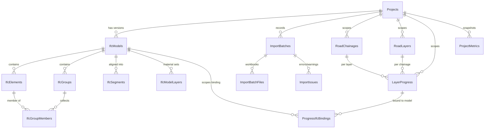

# Phase 4 — PostgreSQL Persistence: Schema Proposal

**Status:** **implemented and verified.** See §13 for what shipped and how it differs from the proposal.

---

## 1. What the inspection turned up

Three findings from the existing code and the live database change the design, so they come first.

### 1.1 `EnsureCreated()` can never add these columns

`Backend/Program.cs:59` calls `context.Database.EnsureCreated()`. That creates the schema **only when no tables exist** and can never alter an existing one. There is no `Backend/Migrations/` folder and the live database has **no `__EFMigrationsHistory` table**.

So Phase 4 cannot proceed by editing the C# models: the new columns would simply never appear on the running database. The first step must be to switch to **EF Core Migrations** and *baseline* the existing schema — see §8.

### 1.2 `BC` means different layers in the demo data and in your Excel

Live `RoadLayers`:

```
SUB  Subgrade Earthwork                 1
GSB  Granular Sub-Base (GSB)            2
WMM  Wet Mix Macadam (WMM)              3
DBM  Dense Bituminous Macadam (DBM)     4
BC   Bituminous Concrete (BC Surface)   5      <-- wearing course
```

Your `RoadLayer.xlsx` uses `BC` for **Base cource** and `SC` for the surface. This is the same collision Phase 1 solved for the IFC side.

**Consequence:** the seeded demo catalogue and an imported catalogue **cannot share one project**. A `UNIQUE (ProjectId, Code)` is correct; a global `UNIQUE (Code)` would be actively wrong. This makes project scoping load-bearing rather than cosmetic — it is what keeps the two meanings of `BC` apart.

### 1.3 There is real data to preserve

```
RoadChainages   100      RoadLayers        5
LayerProgress   500      ProjectMetrics    1      SiteHotspots  3
```

The migration must backfill these into a default project rather than dropping them. `Database/Schema.postgres.sql` starts with `DROP TABLE ... CASCADE` and **must not** be run against this database.

---

## 2. Approach: extend, don't replace

The five existing tables gain a `ProjectId` and source-tracking columns. Genuinely new concepts get new tables. This keeps the five existing controllers, the two PL/pgSQL functions and the seeded rows working.

New table names stay in EF's quoted PascalCase to match what is already there.



---

## 3. New tables

### 3.1 `Projects`

The tenancy boundary. Every other row hangs off it.

| Column | Type | Notes |
|---|---|---|
| `Id` | `integer` identity | **PK** |
| `Code` | `text` | **UNIQUE**, URL-safe slug (`nh-208`) |
| `Name` | `text NOT NULL` | |
| `Description` | `text NULL` | |
| `ChainageDirection` | `text NOT NULL DEFAULT 'auto'` | `CHECK IN ('auto','ascending','descending')` |
| `Metadata` | `jsonb NOT NULL DEFAULT '{}'` | client, contract no., free-form |
| `CreatedAt` / `UpdatedAt` | `timestamptz NOT NULL` | |

`ChainageDirection` is where the **still-open direction question** gets settled per project. `auto` keeps the Phase 2 behaviour (anchors, then `IfcSite`, then ascending); the other two override it. This turns a blocking question into a stored decision.

### 3.2 `IfcModels`

| Column | Type | Notes |
|---|---|---|
| `Id` | `bigint` identity | **PK** |
| `ProjectId` | `integer NOT NULL` | **FK** → `Projects(Id)` `ON DELETE CASCADE` |
| `Version` | `integer NOT NULL` | 1, 2, 3… per project |
| `OriginalFileName` | `text NOT NULL` | `Road.ifc` |
| `StoragePath` | `text NOT NULL` | path/blob key — **the file itself is never in the DB** |
| `ContentSha256` | `char(64) NOT NULL` | file identity |
| `ByteSize` | `bigint NOT NULL` | |
| `SchemaName` | `text NULL` | `IFC2X3` |
| `LengthUnit` | `text NULL` | `MILLI` |
| `SiteLatitude` / `SiteLongitude` / `SiteElevationM` | `double precision NULL` | from `IfcSite` |
| `ElementCount` | `integer NOT NULL` | |
| `CorridorLengthM` / `CorridorWidthM` | `double precision NULL` | |
| `IsActive` | `boolean NOT NULL DEFAULT true` | |
| `UploadedAt` | `timestamptz NOT NULL DEFAULT now()` | |

**Constraints**

- `UNIQUE (ProjectId, Version)`
- `UNIQUE (ProjectId, ContentSha256)` — re-uploading the same bytes is a no-op, not a new version
- `CREATE UNIQUE INDEX ... ON "IfcModels"("ProjectId") WHERE "IsActive"` — exactly one active model per project

### 3.3 `IfcElements`, `IfcGroups`, `IfcGroupMembers`, `IfcSegments`, `IfcModelLayers`

These persist what the parser **extracted** from the file — not anything computed from other DB rows. They exist so bindings mean something without re-parsing, and so the reconciliation report can render before the 3.6 MB WASM parse finishes.

`IfcElements`

| Column | Type | Notes |
|---|---|---|
| `Id` | `bigint` identity | **PK** |
| `IfcModelId` | `bigint NOT NULL` | **FK** → `IfcModels` `ON DELETE CASCADE` |
| `GlobalId` | `text NOT NULL` | 22-char IFC GUID |
| `ExpressId` | `integer NOT NULL` | line number — advisory only, see §6 |
| `Name`, `IfcType` | `text NULL` | `Floor:Subgrade:1675281` |
| `LayerName`, `LayerCode` | `text NULL` | `Subgrade`, `SUB` |
| `SegmentIndex` | `integer NULL` | |
| `BboxMinX/Y/Z`, `BboxMaxX/Y/Z` | `double precision NULL` | |

- `UNIQUE (IfcModelId, GlobalId)` ← the lookup key for binding hydration
- `INDEX (IfcModelId, LayerCode)`, `INDEX (IfcModelId, SegmentIndex)`

`IfcGroups`: `Id` PK, `IfcModelId` FK, `GlobalId`, `Name`; `UNIQUE (IfcModelId, GlobalId)`.
`IfcGroupMembers`: **PK `(IfcGroupId, IfcElementId)`**, both FKs cascade. This is what preserves the surface-course fan-out.
`IfcSegments`: `Id` PK, `IfcModelId` FK, `SegmentIndex`, `StartM`, `EndM`, `CentreM`, `ElementCount`; `UNIQUE (IfcModelId, SegmentIndex)`.
`IfcModelLayers`: `Id` PK, `IfcModelId` FK, `LayerName`, `LayerCode`, `ThicknessMm numeric(10,2)`, `MaterialType`, `SortOrder`; `UNIQUE (IfcModelId, LayerName)`. **This is the winning thickness input** (§7).

### 3.4 `ImportBatches`

| Column | Type | Notes |
|---|---|---|
| `Id` | `bigint` identity | **PK** |
| `ProjectId` | `integer NOT NULL` | **FK** → `Projects` `ON DELETE CASCADE` |
| `Mode` | `text NOT NULL DEFAULT 'incremental'` | `CHECK IN ('incremental','replace')` |
| `Status` | `text NOT NULL` | `CHECK IN ('running','succeeded','failed')` |
| `ContentSha256` | `char(64) NOT NULL` | hash over the **sorted set** of file hashes |
| `RowsInserted`, `RowsUpdated`, `RowsUnchanged`, `RowsRejected` | `integer NOT NULL DEFAULT 0` | |
| `ErrorCount`, `WarningCount` | `integer NOT NULL DEFAULT 0` | |
| `StartedAt` | `timestamptz NOT NULL DEFAULT now()` | |
| `CompletedAt` | `timestamptz NULL` | |
| `ImportedBy` | `text NULL` | |
| `Summary` | `jsonb NOT NULL DEFAULT '{}'` | the Phase 1 `counts` block verbatim |

`INDEX (ProjectId, StartedAt DESC)`.

`RowsUnchanged` is separate from `RowsUpdated` on purpose — a re-import of an identical workbook should report *0 updated, 12 unchanged*, which is the visible proof that idempotency works.

`ImportBatchFiles`: `Id` PK, `ImportBatchId` FK cascade, `FileName`, `SheetName`, `SheetKind` (`CHAINAGES|LAYERS|PROGRESS|METRICS|LEGACY_PROGRESS|UNKNOWN`), `RowCount`, `ContentSha256`, `ByteSize`; `UNIQUE (ImportBatchId, FileName, SheetName)`.

`ImportIssues`: `Id` PK, `ImportBatchId` FK cascade, `Level` (`error|warning|info`), `Code`, `Message`, `SheetName`, `RowNumber`, `FieldName`; `INDEX (ImportBatchId, Level)`. One row per issue the Phase 1/2 validators emit, so the report survives a refresh.

### 3.5 `ProgressIfcBindings` — the core new table

One row per **(progress record, bound element)** pair. A `group` match therefore writes two rows, one per lane slab, which is exactly what the viewer needs.

| Column | Type | Notes |
|---|---|---|
| `Id` | `bigint` identity | **PK** |
| `LayerProgressId` | `integer NOT NULL` | **FK** → `LayerProgress(Id)` `ON DELETE CASCADE` |
| `IfcModelId` | `bigint NOT NULL` | **FK** → `IfcModels(Id)` `ON DELETE CASCADE` |
| `IfcElementGlobalId` | `text NOT NULL` | the element actually bound |
| `SourceRef` | `text NULL` | the `LayerId` cell that produced it |
| `SourceRefKind` | `text NULL` | `CHECK IN ('element','group','none')` |
| `Strategy` | `text NOT NULL` | `CHECK IN ('guid','group','position','name')` |
| `Confidence` | `text NULL` | `CHECK IN ('exact','high','medium')` |
| `SegmentIndex` | `integer NULL` | |
| `BoundAt` | `timestamptz NOT NULL DEFAULT now()` | |
| `BoundByBatchId` | `bigint NULL` | **FK** → `ImportBatches(Id)` `ON DELETE SET NULL` |

**Constraints**

- `UNIQUE (IfcModelId, LayerProgressId, IfcElementGlobalId)` — rebinding is idempotent
- `INDEX (IfcModelId, IfcElementGlobalId)` — the reverse lookup the tint uses
- `FOREIGN KEY (IfcModelId, IfcElementGlobalId)` → `IfcElements(IfcModelId, GlobalId)` — a composite FK, so a binding can never point at an element the model does not contain. Requires `UNIQUE (IfcModelId, GlobalId)` on `IfcElements`, which §3.3 already declares.

Keeping `Strategy` and `Confidence` here is what lets the UI go on showing `via=guid` / `via=group` and `Bound to model · 15/15 elements` without recomputing anything.

**Open question — should one element be bindable by only one progress row?** Phase 2 currently treats a double claim as a *warning* and keeps the first. A partial `UNIQUE (IfcModelId, IfcElementGlobalId)` would make it a hard error and fail the import. **Recommendation: no unique constraint**, keep the warning — a hard constraint turns a reportable data-quality issue into a blocked import. Flagged for your call.

---

## 4. Changes to existing tables

All additive except one index.

### `RoadChainages`

```sql
ALTER TABLE "RoadChainages" ADD COLUMN "ProjectId"         integer;
ALTER TABLE "RoadChainages" ADD COLUMN "SourceChainageId"  integer NULL;
ALTER TABLE "RoadChainages" ADD COLUMN "SourceRowNumber"   integer NULL;
ALTER TABLE "RoadChainages" ADD COLUMN "SortOrder"         integer NULL;
ALTER TABLE "RoadChainages" ADD COLUMN "LastImportBatchId" bigint NULL;
```

- `UNIQUE (ProjectId, SourceChainageId)` ← **idempotency key** (`Id` column of `Road_chainage.xlsx`)
- `SortOrder` carries the direction/order the spec asks for, independent of `Id`

### `RoadLayers`

```sql
ALTER TABLE "RoadLayers" ADD COLUMN "ProjectId"         integer;
ALTER TABLE "RoadLayers" ADD COLUMN "SourceLayerId"     integer NULL;
ALTER TABLE "RoadLayers" ADD COLUMN "LastImportBatchId" bigint NULL;
```

- `UNIQUE (ProjectId, Code)` ← **idempotency key**, and what keeps the two meanings of `BC` apart (§1.2)
- The live table has **no** existing unique index on `Code` (the SQL script declares one but `EnsureCreated` never applied it), so nothing has to be dropped

### `LayerProgress`

```sql
ALTER TABLE "LayerProgress" ADD COLUMN "ProjectId"          integer;
ALTER TABLE "LayerProgress" ADD COLUMN "SourceRowKey"       text NULL;
ALTER TABLE "LayerProgress" ADD COLUMN "SourceRowNumber"    integer NULL;
ALTER TABLE "LayerProgress" ADD COLUMN "SourceStatusText"   text NULL;
ALTER TABLE "LayerProgress" ADD COLUMN "FirstImportBatchId" bigint NULL;
ALTER TABLE "LayerProgress" ADD COLUMN "LastImportBatchId"  bigint NULL;
ALTER TABLE "LayerProgress" ADD COLUMN "SupersededAt"       timestamptz NULL;
```

- `UNIQUE (ProjectId, ChainageId, LayerId)` ← **the central idempotency key**. This is the `(ChainageId, LayerCode)` natural key Phase 1 established, expressed against the resolved FK.
- `SourceRowKey` stores Phase 1's `key` (`"1:SUB"`) and `SourceStatusText` the pre-normalisation `rawStatus` (`"In Progress"`), so an import is reproducible and auditable.
- `SupersededAt` is the soft-delete marker for replace mode (§5).

### `ProjectMetrics`

```sql
ALTER TABLE "ProjectMetrics" ADD COLUMN "ProjectId"        integer;
ALTER TABLE "ProjectMetrics" ADD COLUMN "ImportBatchId"    bigint NULL;
ALTER TABLE "ProjectMetrics" ADD COLUMN "IsSourceSnapshot" boolean NOT NULL DEFAULT true;
```

This table is a borderline case against the no-derived-data rule — budget, actual and progress % **are** recomputable from `LayerProgress`. `SchedulePerformanceIndex` is not, because nothing else carries a schedule baseline. The proposal keeps the row but marks it `IsSourceSnapshot = true`: *this is what the sheet claimed at import time*, never the number the dashboard shows. Live KPIs stay computed. `UNIQUE (ProjectId, ImportBatchId)`.

### `SiteHotspots`

`ProjectId` added for tenancy consistency; otherwise untouched.

---

## 5. Import semantics — replacement vs incremental

The spec asks for this to be settled before any deletion is implemented. Proposal:

| Mode | Behaviour | Deletes? |
|---|---|---|
| `incremental` **(default)** | Upsert every row present in the workbook. Rows absent from the workbook are left exactly as they are. | **Never** |
| `replace` | Upsert as above, then set `SupersededAt = now()` on the project's progress rows the batch did not touch. Reads filter `SupersededAt IS NULL`. | **Never** — soft only |
| hard delete | Not part of any import. A separate, explicitly-named admin endpoint, never reachable from the upload flow. | Yes, on request |

Nothing an import can do removes a row. `replace` is reversible by clearing `SupersededAt`.

---

## 6. Idempotency strategy

Three independent layers.

**Layer 1 — file identity.** `ImportBatches.ContentSha256` over the sorted set of member-file hashes. Re-posting the same workbooks to the same project when the previous batch succeeded returns that batch's result and writes nothing. `?force=true` overrides, for when the model changed underneath.

**Layer 2 — row identity.** Stable business keys, never generated ids:

| Table | Natural key | Source |
|---|---|---|
| `RoadChainages` | `(ProjectId, SourceChainageId)` | `Road_chainage.Id` |
| `RoadLayers` | `(ProjectId, Code)` | `RoadLayer.Code` |
| `LayerProgress` | `(ProjectId, ChainageId, LayerId)` | `(ChainageId, LayerCode)` |

Every write is `INSERT … ON CONFLICT (key) DO UPDATE`. Because `LayerProgress.Id` is never part of the matching, generated ids stay stable across re-imports and existing `ProgressIfcBindings` keep pointing at the right rows.

**Unchanged detection:** before writing, the incoming field set is compared against the stored row. Identical → `RowsUnchanged++`, no write, `UpdatedAt` untouched. So a re-import of the same file reports `0 inserted, 0 updated, 12 unchanged` — and that is the acceptance test for "no duplicates".

**Layer 3 — binding identity.** `UNIQUE (IfcModelId, LayerProgressId, IfcElementGlobalId)`. Rebinding the same model deletes nothing and inserts nothing new; only `Strategy`/`Confidence`/`BoundAt` update if the resolver changed its mind.

**Transaction boundary:** one transaction per batch. The batch row is inserted `Status='running'` and committed separately first, so a crash leaves a visible failed batch rather than nothing. Everything else — chainages, layers, progress, metrics, bindings, issues — commits or rolls back together. A failed import therefore leaves the previous state completely intact.

---

## 7. What is deliberately **not** persisted

Per the derived-data rule:

| Not stored | Recomputed from | By |
|---|---|---|
| Layer roll-up status | bound progress rows | `mergeLayersWithProgress` |
| Layer progress % | bound progress rows | `mergeLayersWithProgress` |
| Segment / chainage matrix | bindings + progress | `deriveSegments` |
| Overall %, CPI, SPI, EV, CV | progress rows | `deriveCostMetrics` |
| Binding counts, `resolvedPercent`, coverage | `ProgressIfcBindings` | aggregate query |
| **Resolved thickness + source** | `IfcModelLayers.ThicknessMm` → `LayerProgress.DesignThicknessMm` → `RoadLayers.ThicknessMm` | `resolveThickness` |
| Layer `Role` (`SUBGRADE`…) | `LayerName` | `classifyLayerRole` |
| Three.js materials, meshes, textures, tint colours, `statusVariant` cache | — | generated at render, never stored |

All three thickness *inputs* are persisted; the winner is not. That is what stops the IFC-wins rule from silently baking a stale number into the database.

`LayerProgress.LevelColorHex` **is** kept — it is a column in the source workbook, a user's display choice, not a computed material colour. `TopLevelMeters` / `BaseLevelMeters` are the opposite: derived running sums that are already recomputed in the app. They are left alone this phase (the PL/pgSQL function reads them) and flagged for removal later.

---

## 8. Migration mechanics

The order matters, and step 1 is the one that is easy to get wrong.

1. **Baseline.** `dotnet ef migrations add 0001_Baseline` generated from the *current* models, then on the existing database insert its row into `__EFMigrationsHistory` **without running it** (`dotnet ef migrations script` → apply only the history insert). Skipping this makes EF try to `CREATE TABLE "RoadChainages"` on a database that already has it.
2. `0002_Projects` — create `Projects`, insert the default row (`Code='default'`, `Name='Legacy 100 KM Demo Corridor'`).
3. `0003_ProjectScoping` — add `ProjectId` **nullable**, backfill `= 1` on all five tables, then `SET NOT NULL`, then add FKs and the scoped unique indexes. Three statements, not one, or the `NOT NULL` fails on existing rows.
4. `0004_ImportBatches` — `ImportBatches`, `ImportBatchFiles`, `ImportIssues`, plus the source-tracking columns.
5. `0005_IfcModels` — `IfcModels`, `IfcElements`, `IfcGroups`, `IfcGroupMembers`, `IfcSegments`, `IfcModelLayers`.
6. `0006_ProgressIfcBindings` — the binding table and its composite FK.
7. **`Program.cs`**: `EnsureCreated()` → `Database.Migrate()`. `DatabaseSeeder` becomes conditional on the default project being empty.

`Database/Schema.postgres.sql` gets regenerated as documentation and keeps its `DROP TABLE` guard **with a warning header**, since running it against the live database would destroy the 500 seeded rows.

---

## 9. API surface

| Method | Route | Purpose |
|---|---|---|
| `GET` | `/api/projects` | list |
| `POST` | `/api/projects` | create |
| `GET` | `/api/projects/{idOrCode}` | project + active model + counts |
| `PATCH` | `/api/projects/{id}` | rename, set `ChainageDirection` |
| `POST` | `/api/projects/{id}/ifc-models` | multipart upload → store file, persist extracted metadata |
| `GET` | `/api/projects/{id}/ifc-models` | version history |
| `GET` | `/api/ifc-models/{id}/elements` | element index (`?layerCode=`, `?segment=`) |
| `GET` | `/api/ifc-models/{id}/file` | stream the IFC back for the viewer |
| `POST` | `/api/projects/{id}/imports` | multipart, N workbooks, `?mode=`, `?force=` → batch |
| `GET` | `/api/projects/{id}/imports` | batch history |
| `GET` | `/api/imports/{batchId}` | status + counts |
| `GET` | `/api/imports/{batchId}/issues` | `?level=error` |
| `GET` | `/api/projects/{id}/chainages` | |
| `GET` | `/api/projects/{id}/layers` | |
| `GET` | `/api/projects/{id}/progress` | `?includeSuperseded=false` |
| `GET` | `/api/projects/{id}/bindings` | `?ifcModelId=` → progress → GlobalId + strategy |
| `PUT` | `/api/projects/{id}/bindings` | replace the binding set for one model (idempotent) |
| `PUT` | `/api/progress/{id}` | manual edit of one record |

Existing routes (`/api/RoadProgress`, `/api/Analytics/...`) keep working against the default project so nothing breaks mid-migration.

### Where does the resolver run?

**Recommendation: the client keeps resolving; the server only persists.** The resolver is 400 lines of subtle JavaScript — group expansion, segment clustering, direction scoring. Porting it to C# creates two implementations that will drift, and the client already holds the parsed model. So:

```
client resolves  ->  PUT /bindings  ->  server validates every GlobalId
                                        exists in IfcElements, then upserts
```

The composite FK makes a bad binding impossible to store even if the client sends one.

---

## 10. Reload path — how Phase 3 is reconstructed

```
GET /api/projects/{code}              project, ChainageDirection, active model
GET /api/ifc-models/{id}/file         -> existing parseIfc() -> elementIndex (expressIDs)
GET /api/projects/{id}/progress       normalised rows
GET /api/projects/{id}/bindings       progress -> GlobalId + strategy
        |
        v
hydrateResolution()   GlobalId -> expressID via the freshly parsed index
        |
        v
same { matches, byExpressID, report } shape resolveProgressToModel() returns
        |
        v
statusByExpressID()  ->  applyStatusByElement()   [unchanged Phase 3 code]
```

One new frontend function, `hydrateResolution()`, produces the Phase 2 result shape from persisted rows instead of by resolving. Everything downstream — `mergeLayersWithProgress`, `deriveSegments`, `SegmentMatrix`, the tint — is untouched.

**Why hydrate through GlobalId rather than storing `ExpressId`:** express ids are IFC line numbers. They are stable for *identical file bytes* but change the moment the model is re-exported, while `GlobalId` is designed to persist across exports. `ExpressId` is stored for debugging only and is never the join key. If a GlobalId is missing from the freshly parsed model, that binding is reported stale and the resolver re-runs — the Phase 2 drift path, unchanged.

---

## 11. Acceptance criteria → mechanism

| Criterion | Mechanism |
|---|---|
| Import persists | §9 `POST /imports`, one transaction |
| Refresh restores | §10 reload path |
| Re-import → no duplicates | §6 layers 1 & 2; reports `unchanged` |
| Updated Excel updates | `ON CONFLICT DO UPDATE` on the natural keys |
| Binding survives refresh | `ProgressIfcBindings` + `hydrateResolution()` |
| Per-element tinting still works | untouched — fed the same `byExpressID` map |
| Layer figures / matrix identical | recomputed by the same functions from the same rows |
| No partial corruption | one transaction per batch; batch row committed first as `running` |
| Projects isolated | `ProjectId` FK on every table; all uniques scoped to it; every query filtered |
| No viewer runtime objects | §7 |

---

## 12. Decisions needed before implementation

1. **Project bootstrap** — the seeded 100 KM demo becomes project `default`. Should an Excel import create a **new** project automatically (from the filename), or must the user create/select one first? (Recommend: explicit selection, because of the `BC` collision in §1.2.)
2. **Double-claimed elements** — hard `UNIQUE` constraint, or keep Phase 2's warning? (Recommend: warning.)
3. **IFC file storage** — local folder (`Backend/Storage/ifc/{projectId}/{sha256}.ifc`) or object storage? (Recommend: local folder now, `StoragePath` keeps it swappable.)
4. **`ProjectMetrics`** — keep as a source snapshot per §4, or drop it entirely and compute everything?
5. **Authentication** — "multiple users cannot modify each other's data" is currently enforced only by `ProjectId` scoping. There is no auth in this codebase at all (`AllowAnyOrigin`, no `[Authorize]`). Is real auth in scope for Phase 4, or is project scoping sufficient for now?
6. **`ChainageDirection`** — should the default project be seeded `auto`, or do you want to settle the `Road.ifc` direction conflict now and store it explicitly?

---

## 13. What shipped

Implemented after sign-off. All six decisions in §12 were resolved as recommended, except
authentication, which you escalated to full JWT plus project membership.

### Backend

| File | Role |
|---|---|
| `Models/AuthModels.cs` | `User`, `ProjectMember`, `ProjectRole` (Viewer < Contributor < Owner) |
| `Models/ProjectModels.cs` | `Project`, `IfcModel`, `IfcElement`, `IfcGroup`, `IfcGroupMember`, `IfcSegment`, `IfcModelLayer` |
| `Models/ImportModels.cs` | `ImportBatch`, `ImportBatchFile`, `ImportIssue`, `ProgressIfcBinding` |
| `Services/JwtTokenService.cs` | Token issue; refuses to start on a missing or short signing key |
| `Services/ProjectAccessService.cs` | The single place project authorization is decided |
| `Services/ProjectImportService.cs` | The transactional, idempotent upsert |
| `Controllers/AuthController.cs` | register / login / me / change-password |
| `Controllers/ProjectsController.cs` | projects, membership, chainages, layers, progress |
| `Controllers/IfcModelsController.cs` | model upload, file download, element/group/segment/layer reads |
| `Controllers/ImportsController.cs` | import, batch history, issues |
| `Controllers/BindingsController.cs` | binding read/replace, single-record progress edit |
| `Data/LegacyScope.cs` | pins the pre-existing endpoints to the demo project |
| `Migrations/…_Phase4Persistence.cs` | idempotent SQL migration |

### Two decisions that changed during implementation

**The migration is hand-written SQL, not EF operations.** The §8 plan called for a
baselined `0001` plus five incremental migrations. In practice EF generates `CreateTable`
for the five pre-existing tables, which fails on the live database. The migration was
rewritten as idempotent SQL — `CREATE TABLE IF NOT EXISTS`, `ADD COLUMN IF NOT EXISTS`,
and a `duplicate_object` guard where PostgreSQL offers no such clause. One file now
produces the same schema from either an existing or an empty database, and can be re-run
safely. The EF model snapshot is kept untouched so future migrations still diff correctly.

**The legacy endpoints were not left alone.** `/api/RoadProgress`, `/api/Analytics`,
`/api/SiteHotspots` and the old Excel upload queried the tables with no notion of a
project. Left as they were, they would have read across every tenant. They now carry
`[Authorize]` and are pinned to the demo project through `LegacyScope`.

### Frontend

`api/client.js` (bearer token, 401 handling), `context/AuthContext.jsx`,
`components/Auth/SignInScreen.jsx`, `components/Auth/ProjectBar.jsx`, and
`utils/persistence.js` — the adapters plus `hydrateResolution()` and `restoreOrResolve()`.
`RoadDataContext` loads a project on selection; the uploader and the 3D viewer both write
through the API and then reload from it.

### Authorization model

| Role | Can |
|---|---|
| Viewer | read everything in the project |
| Contributor | the above, plus import, upload models, edit progress |
| Owner | the above, plus membership management |

Membership is read from the database on every request rather than carried in the token, so
revoking access takes effect at once. A project the caller is not a member of returns
**404, not 403** — the two are deliberately indistinguishable, so the endpoint cannot be
used to discover which project ids exist. The first account registered becomes the system
administrator.

### Verified

| | |
|---|---|
| Backend API, end to end | **32 assertions** across auth, projects, model upload, import, idempotency, updates and tenant isolation |
| Restore round-trip | **11 assertions** comparing restored state against in-memory phase 3 |
| Migration against live data | 100 chainages / 5 layers / 500 progress rows preserved and adopted; zero null `ProjectId` |

Re-importing the identical workbook set reports **0 inserted, 0 updated, 19 unchanged**,
and the restored per-element tint, layer figures, segment matrix and KPIs are identical to
the in-memory values — the base course still shows three different statuses along its
length.

---

## 14. Amendment — `LayerProgress.SourceIfcRef`

Phase 4 moved the workbook's raw `LayerId` cell entirely into
`ProgressIfcBindings.SourceRef`, on the reasoning that the resolved binding superseded it.

Phase 6 testing showed that is only true once bindings exist. A project whose workbooks
were imported **before** any model has none, so a later re-resolve had no GlobalId to match
on and fell back to positional matching for every row — turning nine exact and three group
matches into twelve approximate ones, with nothing but a dashed outline on the plan map to
show for it.

§7 of this proposal called for the column (`IfcGlobalId` on `LayerProgress`). Migration
`ProgressSourceIfcRef` restores it as `SourceIfcRef`. Rows imported before the migration
carry null; re-importing fills them.
